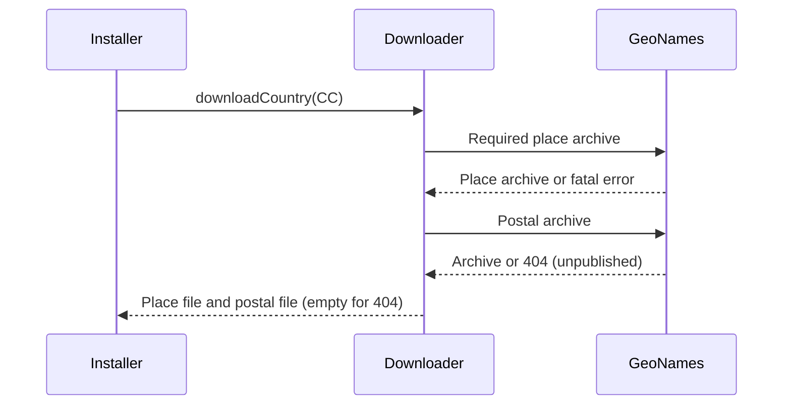

# GeoNames download availability

Country place archives (`export/dump/{CC}.zip`) are required. Postal archives
(`export/zip/{CC}.zip`) are published for only a subset of countries. A postal
HTTP 404 is cached as an empty country postal text file, so stateless installation
imports the available places with zero postal records. Forced downloads recheck
availability. Other HTTP errors, missing place archives and invalid ZIP contents
still fail installation; no geographic or postal records are fabricated.

Province and district imports prefer the downloaded admin1/admin2 reference files.
Postal imports retain the reconciled country-qualified admin1 code (for example `AL.40`).
When resolving a postal place through its province, use this stable key rather
than the postal feed's translated province name: `Qarku i Beratit` in the postal
feed and `Berat County` in the place feed both identify `AL.40`. Legacy callers
without a province code continue to use their supplied province name. Postal and
place exports can use different administrative code schemes: postal Adrar is `01`,
but place Adrar is `DZ.34` (place `DZ.01` means Algiers). An exact unique name in
the country's reference feed takes precedence over a postal code. Published ADM1
aliases in the country place dump are joined by GeoNames ID; matching normalizes
case, spaces and hyphens (`El-Bayadh` and `El Bayadh`). Ambiguous names
never choose an arbitrary province.

## Postal parent references

Postal feeds sometimes supply a country label in the province field, as with
American Samoa's Pago Pago record. When the postal province cannot be reconciled,
use a unique populated-place name from that country's place dump and its published
admin1 code. Ambiguous names never select an arbitrary province.
Province-to-district lookups use the same `NoClassification` relationship type
that geography installation writes; the generic hierarchy default is a different type.
