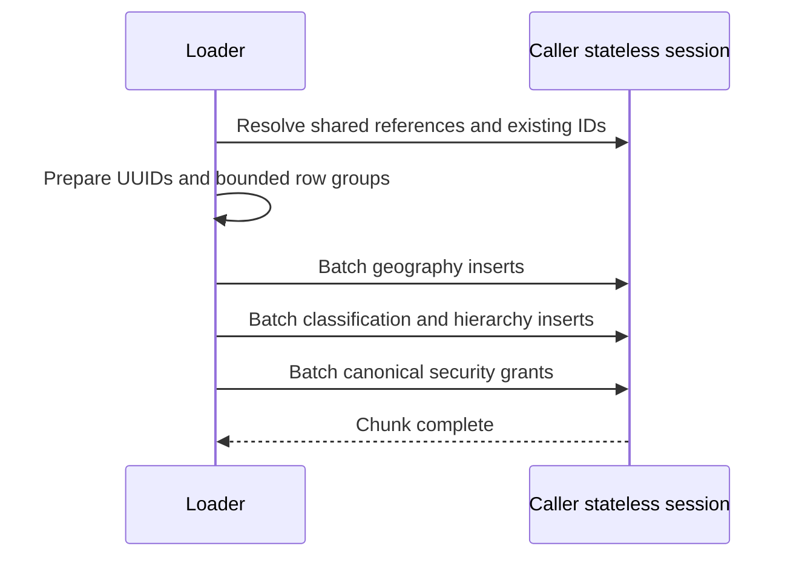

# Stateless geography bulk imports

The country place loader prepares bounded chunks of geography rows with UUIDs
assigned before persistence. It resolves active flags and classification references
once, and identifies existing places by enterprise and GeoNames ID. Names are not
identifiers: two distinct places can have the same name.

Persist each chunk sequentially on the caller's stateless session: geography rows,
attribute links, hierarchy links, then default security rows. Reuse the canonical
ActivityMaster grant matrix and secure every newly inserted row and relationship.
The caller retains transaction ownership; a failed batch fails that transaction.
Optional country resource providers also describe current country resources on
list/detail reads. Country DTOs carry nullable `flagResourceId` and
`flagSystemName`; flags remain an optional module. The provider resolves readable
FSDM relationships using the caller's session and tokens, without caching IDs.
Reruns reuse existing IDs and only add absent hierarchy links.

Postal imports also prepare bounded chunks. Resolve town IDs and existing postal
rows with scalar queries, create missing towns under the published province's
first district, and insert postal codes, suburbs, attributes, relationships and
canonical grants in dependency order. Reuse the existing numeric code formatting
and postal code/suburb identities. A failed chunk rolls back with the caller's
transaction, and reruns add only missing relationships.

Downloaded country CSVs are streamed while their reader is open. The place loader
retains only published district IDs and their direct hierarchy children, the rows
it imports, so unrelated features in a large country dump do not fill the heap.
GeoNames exports are UTF-8 tab-delimited text. Double quotes in place names are
literal characters, not CSV quoting; disable quote interpretation for these feeds.

Concurrent imports require separately owned sessions and transactions. The loader
does not split the caller's transaction or run concurrent operations on its session.
